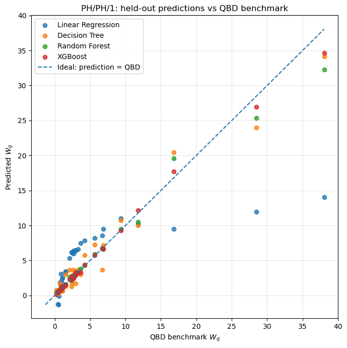
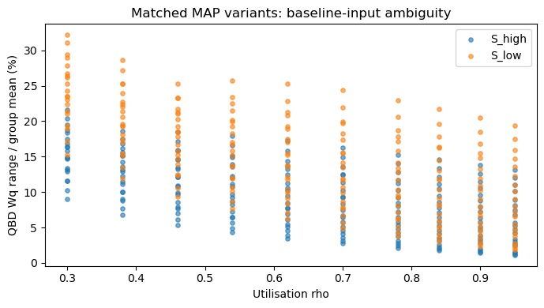

# Machine Learning for Queueing System Performance Prediction

This research project was completed as part of the Master of Data Science at the University of Auckland. It asks how accurately machine learning can predict steady-state queueing performance from system characteristics, and how much those characteristics reveal as arrival and service processes become more complex.

The primary target is the long-run **mean waiting time in queue**, $W_q$, for a stable first-come, first-served single-server system. Experiments 2–4 also derive the mean number waiting, $L_q$, through Little’s law. The M/M/1 notebook establishes the simulation baseline and contains a supplementary one-step forecasting task.

## Queueing models and notebook order

| Experiment | Queue and purpose | Notebook | Saved figure |
| --- | --- | --- | --- |
| 1. M/M/1 | Poisson arrivals and exponential service. Validate the simulator against closed-form steady-state results. | [Simulator validation](notebooks/01_mm1_simulator_validation.ipynb) | [Waiting time validation](figures/01_mm1_waiting_time_validation.png) |
| 2. M/GI/1 | Poisson arrivals and gamma service. Train regressors on simulation labels and compare them with the Pollaczek–Khinchine formula. | [Gamma service](notebooks/02_mgi1_gamma_service.ipynb) | [Predictions vs. theory](figures/02_mgi1_predictions_vs_theory.png) |
| 3. M/PH/1 | Poisson arrivals and phase-type service. Transfer the design to phase-type distributions and study low and high service variability. | [Service variability](notebooks/03_mph1_service_variability.ipynb) | [Predictions vs. theory](figures/03_mph1_predictions_vs_theory.png) |
| 4. PH/PH/1 | Phase-type renewal interarrival times and phase-type service. Vary arrival and service variability and use a matrix-geometric quasi-birth-and-death (QBD) benchmark. | [Arrival and service variability](notebooks/04_phph1_arrival_service_variability.ipynb) | [Predictions vs. QBD](figures/04_phph1_predictions_vs_qbd.png) |
| 5. MAP/PH/1 | Markovian arrival processes and phase-type service. Compare renewal arrivals with Markov-modulated Poisson arrivals at matched input moments. | [Arrival dependence](notebooks/05_mapph1_arrival_dependence.ipynb) | [Matched-arrival waiting-time spread](figures/05_mapph1_matched_arrival_spread.png) |

## Experimental design

- **Simulation labels.** The main designs use 30 replications per configuration. Each stationary run in Experiments 2–5 uses 10,000 simulated time units of warm-up and 40,000 of recording. The replication mean provides the $W_q$ training label, and a Student-t interval describes its Monte Carlo uncertainty. Experiment 1 uses a 20,000-unit validation recording and includes a run-length pilot.
- **Configuration splits.** The selected 300-configuration designs in Experiments 2–4 each use 240 training, 30 validation and 30 test configurations. Experiment 5 uses 2,000 configurations and 60,000 replications. Each service-variability region has an 800/100/100 configuration split. All five arrival variants sharing the same utilisation and arrival and service variability stay in the same split.
- **Benchmarks.** Experiments 2 and 3 use the Pollaczek–Khinchine formula. Experiments 4 and 5 use numerical QBD benchmarks. The prediction analyses report held-out error separately against the simulated means and the corresponding benchmarks.

## Machine learning methods

The stationary experiments compare ordinary least-squares linear regression, a decision tree, a random forest and XGBoost. Their inputs start with utilisation $\rho$ and the squared coefficient of variation (SCV) of service times. PH/PH/1 adds interarrival SCV. MAP/PH/1 compares those three features with an additional feature measuring lag-one interarrival correlation. The tree-based models are tuned by validation RMSE against simulation labels, then refitted on the combined training and validation sets before test evaluation.

## Main results

In M/M/1, the analytical $W_q$ and $L_q$ values fell within the reported 95% simulation intervals at all six tested utilisations. The absolute relative error for mean waiting time was below 1% through $\rho=0.90$ and about 6.2% at $\rho=0.95$.

Across the main stationary datasets, the mean absolute relative difference between simulated and benchmark $W_q$ was 0.86% for M/GI/1, 0.83% for M/PH/1, and 1.13% for PH/PH/1. For MAP/PH/1 it was 0.98% in the low-service-SCV region and 1.25% in the high-service-SCV region.

### Held-out stationary prediction

The table reports $W_q$ RMSE in simulated time units on the 30 held-out configurations from each main 300-configuration design. All values are measured against the queueing benchmark.

| Queue | Benchmark | Linear regression | Decision tree | Random forest | XGBoost |
| --- | --- | ---: | ---: | ---: | ---: |
| M/GI/1 | Pollaczek–Khinchine | 2.1579 | 0.7114 | 0.3418 | **0.3041** |
| M/PH/1 | Pollaczek–Khinchine | 2.1561 | 0.7938 | 0.3665 | **0.1558** |
| PH/PH/1 | QBD | 5.9954 | 1.6293 | 1.3377 | **0.7145** |

XGBoost had the lowest benchmark RMSE in all three combined designs. Rankings changed with the error metric and the variability regime. For example, random forest had a lower MAPE than XGBoost in the final M/GI/1 experiment (5.12% versus 6.61%). In the separate M/PH/1 experiments, random forest led by benchmark RMSE below service SCV 1 and the decision tree led above 1.



### What arrival dependence adds

In MAP/PH/1, configurations can share utilisation and both SCVs and still have different benchmark waiting times. The mean within-group QBD waiting-time range, expressed as a percentage of the group mean, was **14.70%** in the low-service-SCV region and **9.42%** in the high-service-SCV region. The regional XGBoost results show how adding lag-one correlation affected the two held-out metrics.

| Service SCV | Baseline QBD RMSE | RMSE with lag-one correlation | Baseline QBD MAPE | MAPE with lag-one correlation |
| --- | ---: | ---: | ---: | ---: |
| Below 1 | 0.2439 | 0.1707 | 6.45% | 5.79% |
| Above 1 | 0.4444 | 0.4669 | 6.76% | 2.94% |

Pooling both regions for training and adding lag-one correlation produced XGBoost QBD RMSEs of 0.1270 and 0.3198 on the same low- and high-SCV test sets, respectively. This pooled analysis is supplementary.



## Running the notebooks

The notebooks include their saved outputs for inspection on GitHub. For local use, create a Python 3.12 environment from the repository root. The requirements pin the scientific package versions recorded in Experiment 1 and the Jupyter packages checked locally.

```bash
python3.12 -m venv .venv
source .venv/bin/activate
python -m pip install -r requirements.txt
python -m ipykernel install --sys-prefix --name data-analysis-env --display-name "Python (Queueing Research)"
python -m notebook
```

1. Open a notebook and select **Python (Queueing Research)**. Execute its cells from top to bottom in a fresh kernel when rerunning it.
2. All inputs are generated from parameters in the notebooks. Cells that read CSVs in Experiments 2 and 5 use files written earlier in the same notebook. Generated files go into experiment-specific directories relative to the kernel’s working directory.
3. Full runs create simulation outputs and may take substantial time. Experiment 5 defaults to `RUN_MODE='full'`. Set `RUN_MODE='smoke'` in a working copy for a small functional check. Formal metrics come from the full mode. Experiment 1’s supplementary forecasting and Experiment 4’s additional analyses also have run flags.

The reported numbers and extracted figures come from the saved notebook outputs. Repository preparation verified file integrity, notebook structure and imports in the local Python 3.12.7 environment. The built-in MAP/PH/1 smoke mode passed with 40 configurations and 80 replications. Full experimental reproduction in a fresh environment remains unverified.

## Research limitations

- The results reflect synthetic, stable single-server queues, the tested parameter grids and the chosen distribution families. Waiting time is sensitive to small changes near saturation, and the simulation estimates show greater uncertainty at high utilisation.
- Matching arrival moments leaves higher moments and other dependence properties free to vary. The MAP comparison therefore measures the practical value of adding a feature on this design. It cannot isolate a causal effect of lag-one correlation.
- The M/GI/1 baseline and final comparisons use the same held-out configurations. In the expanded design, one held-out configuration and one added training configuration reuse the same 30 replication seeds, limiting their Monte Carlo independence.
- Benchmark errors depend on the target scale and test distribution. Raw RMSE describes errors within each design, and MAPE can be sensitive to small waiting times.

## Repository structure

```text
.
├── README.md
├── requirements.txt
├── .gitignore
├── data/         # Repository placeholder for data
├── figures/      # Selected plots from saved notebook outputs
└── notebooks/    # Five notebooks in experiment order, with saved outputs
```
